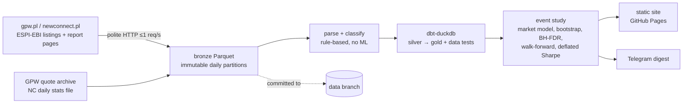

# Undercurrent

> **Undercurrent — what moves beneath the tape.**

A nightly radar for the Warsaw Stock Exchange (GPW + NewConnect). Every trading evening it
reads every ESPI/EBI current report, picks out the events that matter (insider transactions,
holder threshold crossings, price-sensitive inside information), and shows how that kind of
event has moved prices in the past, measured honestly and after costs. One Telegram message
and a static dashboard, rebuilt every night by GitHub Actions.

**Not investment advice. Historical statistics only.**


*Design mock-up (sample data). The live site is at https://almera-vs.github.io/undercurrent/
in Polish, with an English version at https://almera-vs.github.io/undercurrent/en/. Report
titles are always shown as published, in Polish. Its numbers come from the real pipeline and
will look different.*

## How it works



1. **Ingest** (`ingest.py`): the day's report listing from gpw.pl and newconnect.pl, each
   current report's page (legal basis, subject, body, attachment list), the GPW share and
   index archive, and the NewConnect daily file. Written to `bronze/<table>/date=…/part-N.parquet`.
   Partitions are never rewritten, and re-runs are idempotent.
2. **Parse & classify** (`classify.py`, `parse.py`, `resolve.py`): legal basis → signal type,
   keyword sub-types, insider fields from the report text, issuer → ISIN.
3. **dbt** (`dbt/`): silver reports and prices, adjusted prices from the exchange's own
   reference prices, events aligned to the trading calendar, and data tests, including the
   "no unexplained > 35 % jump" gate.
4. **Study** (`study.py`): CARs vs WIG, 95 % bootstrap CIs, Benjamini–Hochberg q-values,
   expanding-window walk-forward with 0.3 % costs, deflated Sharpe, and a verdict per signal.
   Point-in-time and byte-for-byte reproducible.
5. **Publish** (`publish.py`, `i18n.py`): Jinja2 site in Polish and English with inline SVG
   charts, plus a Telegram digest via
   the Bot API.
6. **Commit**: new partitions to the `data` branch, digest archive to `main`.

Details: [`docs/METHODOLOGY.md`](docs/METHODOLOGY.md) · sources and their verification:
[`docs/SOURCES.md`](docs/SOURCES.md) · every judgment call: [`docs/DECISIONS.md`](docs/DECISIONS.md)
· what 1,000× would need: [`docs/SCALING.md`](docs/SCALING.md).

## Results

Statistics need history: the market model uses 250 sessions before each event, and the
walk-forward test needs past years to choose a rule. The 2015 → today backfill is still
filling the lake, so the site shows empty statistics rather than made-up ones until enough
history exists. This section will then state plainly whether any rule held up after costs
out of sample, or that none did.

Limitations that shape the results:

- **Insider trade details are mostly missing.** The MAR Art. 19 notification forms are PDF
  attachments behind bot protection, which Undercurrent does not get around. Side, volume
  and price are known only when the issuer restates them in the report text.
- Insider-field accuracy is measured on hand-labelled real reports that were also used to
  develop the rules, so it is optimistic until a held-out set is labelled.

## Run it

Everything runs in GitHub Actions: `daily.yml` (weekdays 17:47 UTC), `backfill.yml`
(`start`/`end`, one month per job, sequential), `compact.yml` (monthly), `watchdog.yml`
(freshness alert), `ci.yml` (lint, types, tests, dbt data tests against the real lake),
`probe.yml` (source reachability).

Locally (optional):

```bash
uv sync --all-groups
git worktree add data origin/data
uv run undercurrent --data-dir data run --date 2026-11-06 --no-wait-nc --no-publish
uv run undercurrent --data-dir data publish --date 2026-11-06 --no-send
uv run pytest
```

Secrets (GitHub Actions only): `TELEGRAM_BOT_TOKEN`, `TELEGRAM_CHAT_ID`.

## Design principles

- **Zero cost**: GitHub (Actions, Pages) and a Telegram bot. No service that needs a payment
  method.
- **Runs entirely in GitHub Actions**, including backfills and tests.
- **Deterministic rules**: classification and parsing are plain rules, no machine learning.
- **No secrets in git**: tokens live in GitHub Actions secrets only.
- **Exchange data first**: reports and prices come from gpw.pl and newconnect.pl. No raw
  PDFs are stored in git.
- **Polite scraping**: at most one request per second with jitter, an honest User-Agent,
  conditional requests and caching. Bot-protected endpoints are not bypassed.

Small stack on purpose: Python 3.12, uv, DuckDB, Parquet, dbt-duckdb, Polars, Jinja2. No Kafka,
Iceberg, orchestrator or cloud database (see SCALING.md for why).
