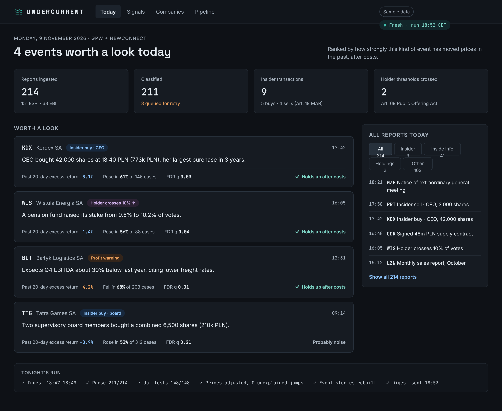
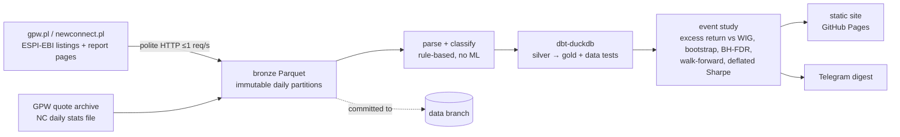

# Undercurrent

> **Undercurrent — what moves beneath the tape.**

A nightly radar for the Warsaw Stock Exchange (GPW + NewConnect). Every trading evening it
reads every ESPI/EBI current report, picks out the events that matter (insider transactions,
holder threshold crossings, price-sensitive inside information), and shows how that kind of
event has moved prices in the past, measured honestly and after costs. One Telegram message
and a static dashboard, rebuilt every night by GitHub Actions.

**Not investment advice. Historical statistics only.**



*Design mock-up (sample data). The live site is at https://almera-vs.github.io/undercurrent/
in Polish, with an English version at https://almera-vs.github.io/undercurrent/en/. Report
titles are always shown as published, in Polish. Its numbers come from the real pipeline and
will look different.*

## How it works



1. **Ingest** (`ingest.py`): the day's report listing from gpw.pl and newconnect.pl, each
   current report's page (legal basis, subject, body, attachment list), the GPW share and
   index archive, and the NewConnect daily file. For insider reports, the attached MAR
   notification form is read from a portal copy (`portals.py`, `forms.py`). Written to
   `bronze/<table>/date=…/part-N.parquet`. Partitions are never rewritten, and re-runs are
   idempotent.
2. **Parse & classify** (`classify.py`, `parse.py`, `resolve.py`): legal basis → signal type,
   keyword sub-types, insider fields from the notification form (or the report text when no
   form is found), issuer → ISIN.
3. **dbt** (`dbt/`): silver reports and prices, adjusted prices from the exchange's own
   reference prices, events aligned to the trading calendar, and data tests, including the
   "no > 35 % jump without a trade" gate.
4. **Study** (`study.py`): excess returns vs WIG, 95 % bootstrap CIs, Benjamini–Hochberg q-values,
   expanding-window walk-forward after costs (2.0 % GPW, 5.2 % NewConnect), deflated Sharpe, and a
   verdict per signal. Only stocks a reader could buy count: median close of at least
   0.50 zł and median daily turnover of at least 10,000 zł before the event.
   **Stock of the week** (`pick.py`, `pick_features.py`): ridge regression on the ranks of
   trend, risk, liquidity and news-flow features picks the liquid WIG stock with the highest
   expected 20-session result against WIG. It is tested walk-forward after costs against
   momentum and the whole universe, and keeps a live record that is never rewritten.
   Point-in-time and byte-for-byte reproducible.
   **Market state** (`vol.py`, `beta.py`, `regime.py`, `market_state.py`): one row per stock
   and session with GARCH volatility, Kalman betas to WIG and bonds, the session's surprise,
   the market regime, liquidity and a per-stock trading cost: the one shared input, so every
   page reads one set of numbers. The stock of the week reads it, puts a self-correcting 90 %
   band on every forecast, keeps an append-only ledger of them, and builds a weekly basket
   weighted by hierarchical risk parity (`basket.py`); event pages show the same forecast.
5. **Publish** (`publish.py`, `pages.py`, `i18n.py`): Jinja2 site in Polish and English with
   inline SVG charts, plain-language summaries, the report's own text, the stock's price and
   liquidity, a glossary, and a Telegram digest via the Bot API. Event pages link to the
   company on XTB only when XTB's page shows the same ISIN (`xtb.py`).
6. **Commit**: new partitions to the `data` branch, digest archive to `main`.

Details: [`docs/METHODOLOGY.md`](docs/METHODOLOGY.md) · sources and their verification:
[`docs/SOURCES.md`](docs/SOURCES.md) · every judgment call: [`docs/DECISIONS.md`](docs/DECISIONS.md)
· what 1,000× would need: [`docs/SCALING.md`](docs/SCALING.md).

## Results

Statistics need history: the walk-forward test needs past years to choose a rule from. The
2015 → today backfill is still filling the lake, so most signal types have little to go on
yet. On the history loaded so far (2015–2016) no signal type moves prices in a way that is
statistically distinguishable from noise once repeated filings and calendar clustering are
accounted for, and none survives trading costs out of sample. This section will be updated
when the backfill completes.

Limitations that shape the results:

- **Insider trade details depend on portal copies.** The exchange serves the MAR Art. 19
  notification forms only behind bot protection, which Undercurrent does not get around.
  The forms are read from copies on parkiet.com, bankier.pl and biznesradar.pl instead; when
  none has a copy, side, volume and price come from the report text, if it states them.
- Insider-field accuracy is measured on hand-labelled real reports that were also used to
  develop the rules, so it is optimistic until a held-out set is labelled.

## Run it

Everything runs in GitHub Actions: `daily.yml` (weekdays, soon after the 18:30 Warsaw cut-off), `backfill.yml`
(`start`/`end`, one month per job, sequential), `compact.yml` (monthly), `watchdog.yml`
(freshness alert), `ci.yml` (lint, types, tests, dbt data tests against the real lake),
`probe.yml` (source reachability).

Locally (optional):

```bash
uv sync --all-groups
git worktree add data origin/data
uv run undercurrent --data-dir data run --date 2026-11-06 --no-wait-nc --no-publish
uv run undercurrent --data-dir data publish --date 2026-11-06 --no-send
uv run pytest
```

Secrets (GitHub Actions only): `TELEGRAM_BOT_TOKEN`, `TELEGRAM_CHAT_ID`.

## Design principles

- **Zero cost**: GitHub (Actions, Pages) and a Telegram bot. No service that needs a payment
  method.
- **Runs entirely in GitHub Actions**, including backfills and tests.
- **Deterministic rules**: classification and parsing are plain rules, no machine learning.
- **No secrets in git**: tokens live in GitHub Actions secrets only.
- **Exchange data first**: reports and prices come from gpw.pl and newconnect.pl. Insider
  notification forms come from copies on three financial portals. PDFs are read in memory;
  none is stored in git.
- **Polite scraping**: at most one request per second with jitter, an honest User-Agent,
  conditional requests and caching. Bot-protected endpoints are not bypassed.

Small stack on purpose: Python 3.12, uv, DuckDB, Parquet, dbt-duckdb, Polars, Jinja2. No Kafka,
Iceberg, orchestrator or cloud database (see SCALING.md for why).
